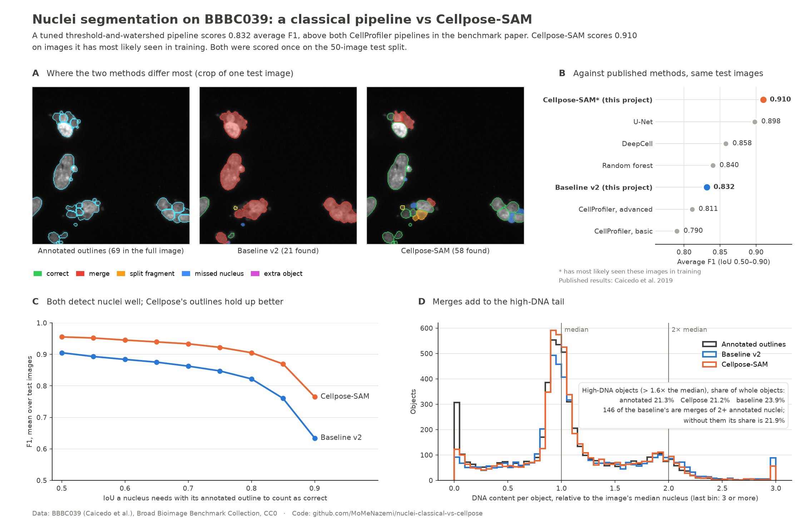

# Classical segmentation vs Cellpose-SAM on BBBC039 nuclei

[](https://github.com/MoMeNazemi/nuclei-classical-vs-cellpose/actions/workflows/tests.yml)



A weekend project comparing a classical nuclei-segmentation pipeline
(smoothing, one global threshold, watershed) with a pretrained foundation
model, [Cellpose-SAM](https://www.biorxiv.org/content/10.1101/2025.04.28.651001.full.pdf),
on [BBBC039](https://bbbc.broadinstitute.org/BBBC039): 200 fluorescence images
of U2OS cell nuclei from a chemical screen, one compound per image, with about
23,000 hand-annotated nuclei. Both methods are judged nucleus by nucleus
(missed, merged and wrongly split objects, not just pixel overlap) and by what
a biologist would measure from them: nucleus counts, nuclear area and DNA
content.

## Findings

1. **The classical pipeline scores above both CellProfiler pipelines in the
   benchmark paper.** Tuned on the training split only, it reaches 0.832
   average F1 on the test split, against 0.790 and 0.811 for the two
   CellProfiler configurations the paper reports. Other CellProfiler setups
   could score differently, and on 50 test images the 0.02 gap to the
   advanced one is small. It needs 0.1 s per image on one CPU core.
2. **Cellpose-SAM scores higher (0.910), but has probably seen the test
   images.** Cellpose's nuclei training data includes BBBC039, so this
   benchmark is not a fair test of it. A follow-up compares both methods on a
   dataset neither has seen.
3. **Merge errors show up as high-DNA objects.** A merge adds up the DNA of
   every nucleus it covers, so it lands in the high tail of the DNA-content
   distribution, where G2/M cells would sit in an untreated culture. 146 of
   the baseline's high-DNA objects (more than 1.6× the image's median
   nucleus) are merges: 117 cover two annotated nuclei and 29 cover three or
   more. Its high-DNA share of whole objects is 23.9%, against 21.3% for the
   annotated outlines and 21.2% for Cellpose; without those merges it would
   be 21.9%.
4. **DNA content survives outline errors better than area.** For the nuclei
   each method finds (IoU above 0.5), DNA content is within ±10% of the
   annotated value for 90% (baseline) and 95% (Cellpose) of them, area for
   only 75% and 86%. On the 4,950 nuclei both methods found, the gap holds:
   DNA content 90.5% against 97.0%, area 75.0% against 87.8%. Edge pixels are
   dim, so a ring of them changes the area much more than the summed signal.
5. **The biggest improvement came from reading a library's behaviour, not
   from tuning.** scikit-image's `h_maxima` keeps two peaks of exactly equal
   height however shallow the dip between them, and distance-transform values
   tie often, so single nuclei were cut in two whatever the setting.
   Replacing it removed 95% of the first version's splits.
6. **Ground truth is a convention.** In the hardest test image, many nuclei
   appear broken into clusters of round fragments, which is typical of dying
   cells, and the annotators outlined every fragment: 69 objects. The
   baseline finds 21 objects, roughly one per cluster, which is probably
   closer to the number of cells; Cellpose finds 58. Which answer is right
   depends on whether you are counting cells or measuring fragmentation.

## Results on the test split (50 images, scored once)

| | Classical baseline | Cellpose-SAM¹ |
|---|---|---|
| Average F1 (IoU 0.50–0.90) | 0.832 | 0.910 |
| F1 at IoU 0.5 | 0.905 | 0.955 |
| Precision / recall at IoU 0.5 | 0.953 / 0.871 | 0.979 / 0.937 |
| Merges / splits | 255 / 53 | 97 / 25 |
| Missed / extra | 246 / 29 | 214 / 48 |
| Nucleus count error per image, mean | 9.0% | 4.5% |
| Median time per image | 0.10 s, one CPU core | 0.76 s, RTX 4070 laptop GPU |

¹ Most likely trained on these images (see [Training-data overlap](#training-data-overlap)).

| Published results on the same test images ([Caicedo et al. 2019](https://pmc.ncbi.nlm.nih.gov/articles/PMC6771982)) | Average F1 |
|---|---|
| U-Net | 0.898 |
| DeepCell | 0.858 |
| Random forest | 0.840 |
| CellProfiler, advanced configuration | 0.811 |
| CellProfiler, basic configuration (global Otsu + declumping) | 0.790 |

Every table and figure, regenerated from the saved results, is in
[docs/results.md](docs/results.md); the files behind them are in
[docs/results/](docs/results/).

## How it works

**Classical baseline** (`src/nuclei/baseline.py`): Gaussian smoothing (σ = 1 px),
one global Li threshold raised by 25%, hole filling, then a watershed on the
distance transform, seeded by distance peaks that rise at least 1 px above
the pass to any higher peak. Objects under 16 px are dropped, and fields
whose "foreground" is under 1.5× brighter than the background return
nothing. All settings were chosen by a grid search on the training split.

**Cellpose-SAM** (`src/nuclei/pretrained.py`): the pretrained `cpsam_v2` model
with Cellpose's default thresholds, which won a small search over two models
and nine threshold settings on the training split.

**Evaluation** (`src/nuclei/evaluate.py`), following the benchmark paper:

- **Average F1**: a predicted nucleus is correct at threshold *t* if its
  intersection over union (IoU) with an annotated nucleus is above *t*. F1 is
  computed per image at *t* = 0.50, 0.55, …, 0.90, averaged over images, then
  over thresholds. The strict thresholds reward accurate outlines.
- **Area bias**: how much larger (+) or smaller (−) the outlines of correctly
  found nuclei are than the annotated ones (a geometric mean of the ratios).
- **Error types** ("most of" = more than half of an object's pixels):

| Error | Definition |
|---|---|
| merge | one prediction covers most of two or more annotated nuclei |
| split | one annotated nucleus contains most of two or more predictions |
| missed | an annotated nucleus no prediction covers mostly or lies mostly inside |
| extra | a prediction that neither covers most of a nucleus nor lies mostly inside one |

The benchmark's own code flags merges and splits by IoU > 0.1, which misses
thin fragments and counts a neighbour's slight overreach as a merge; its
counts are kept in the output tables as `merges_ref` and `splits_ref`.
Annotated objects are not filtered by size, so micronuclei count.

**Measurements** (`src/nuclei/measure.py`): DNA content is the
background-subtracted Hoechst signal summed over an object, on a relative
scale where 1 is the image's median annotated nucleus. In an untreated,
growing culture that median would be a G1 nucleus, but every BBBC039 image
shows a different compound, and a compound that arrests cells can move it.
So the scale is used to compare sets of outlines with each other, not to
assign cell-cycle phases. Background and scale both come from the annotated
outlines, so every method is measured against the same reference.

**Protocol**: settings were chosen on the training split and checked, with
error analysis, on the validation split. The test scores were computed once,
by `04_test.py`, after both methods were frozen. No earlier step opens a test
image: `01_inspect.py` only checks that the test files exist. (Its first
version also drew two test overlays and counted test nuclei; nothing from
them was used to choose settings.) `04_test.py` refuses to overwrite its
results unless forced, which guards against accidental reruns.

## Training-data overlap

Cellpose's nuclei training set was assembled from public data that includes
BBBC039 itself: 157 of its images directly, the rest through the Data Science
Bowl 2018 set (BBBC038) they overlap with
([Stringer et al., Cellpose preprint](https://www.biorxiv.org/content/10.1101/2020.02.02.931238v1.full-text)).
Cellpose held out about 10% of that data (111 of 1,139 images) as its own test
set, and Cellpose-SAM was trained on the rest, among other sets
([Pachitariu et al. 2025](https://www.biorxiv.org/content/10.1101/2025.04.28.651001.full.pdf)).
So Cellpose has most likely been trained on most BBBC039 images, test split
included: its score here is a ceiling on seen data, not a generalisation
result.

## Limitations

- One dataset: one cell line, one stain, one imaging setup.
- Cellpose has most likely seen the test images (above).
- The DNA scale is relative to each image's median nucleus, with no G1
  calibration, so the analysis makes no cell-cycle phase claims.
- Background and scale come from the annotated outlines. That is right for
  comparing methods; a pipeline without annotations would have to estimate
  them itself.
- 50 test images and no confidence intervals: small differences, such as
  0.832 against 0.811, may not hold on other images.
- Both methods, like every method in the benchmark paper, miss most
  micronuclei.

## Development log

**Version 1** (Li threshold, distance-transform watershed seeded with
`h_maxima`, h = 1 px) reached 0.636 average F1 on validation. Its error
overlays showed single elongated nuclei cut in two, and raising h reduced
those splits only slowly while merges climbed steeply.

**Version 2** changes, all decided before any test score was computed:

1. Settings are selected by average F1 rather than F1 at IoU 0.5, because
   later steps measure nucleus size and DNA content, so outlines matter.
2. Seeds come from a tie-safe peak test instead of `h_maxima`.
3. The grid search also tried a size-relative seed rule, seeds from
   brightness peaks, and a threshold correction factor.
4. An empty-field guard: a global threshold always splits the histogram in
   two, so on an empty field it segments noise.

What each change contributed, on the training split (the guard's row leaves
out the two empty fields, which is all the guard changes):

| Training (100 images) | Average F1 | F1 at 0.5 | Area bias | Merges | Splits | Missed | Extra |
|---|---|---|---|---|---|---|---|
| Version 1 | 0.635 | 0.783 | +7.4% | 667 | 1,316 | 240 | 273 |
| + empty-field guard | 0.648 | 0.799 | +7.4% | 667 | 1,316 | 240 | 130 |
| + tie-safe seeds | 0.781 | 0.903 | +11.7% | 720 | 71 | 232 | 124 |
| + threshold × 1.25 = version 2 | 0.833 | 0.906 | +0.1% | 533 | 114 | 515 | 68 |

The threshold factor mostly fixed outlines (area bias from +11.7% to +0.1%), at
the cost of more missed dim and tiny objects. The size-relative seed rule
(0.827) and brightness-peak seeds (0.801) did not beat the fixed h. Training
(0.833), validation (0.838) and test (0.832) scores are close, so there is no
sign that the search fitted the training images at the expense of new ones.

### Dataset notes

- Three fields have no nuclei at all (two training, one validation): only
  noise and uneven illumination. Version 1 turned them into 40–103 objects;
  the guard returns nothing.
- Micronuclei are annotated as separate objects. Both methods here, like
  every method in the benchmark paper, miss most of them.

## What's in this repository

| Path | Contents |
|---|---|
| `src/nuclei/` | The package: data loading, both methods, evaluation, measurements, figures |
| `scripts/` | Steps 01–07, run in order (below) |
| `tests/` | Checks on small synthetic images with known answers, run on every push |
| `docs/results.md` | Every result table and figure, generated by `06_report.py` |
| `docs/results/` | Frozen settings, grid searches, validation and test summaries, per-image test scores, library versions |
| `docs/figures/` | The figures, including error overlays of test images |

The images, predicted masks and per-object tables are not stored here: the
data is downloaded from the Broad Institute, and the rest is regenerated by
the scripts.

## Reproduce

Data: download `images.zip`, `masks.zip` and `metadata.zip` from the
[BBBC039 page](https://bbbc.broadinstitute.org/BBBC039) and unzip them into
`data/raw/`.

```
python -m venv .venv
.venv\Scripts\activate          # Windows; on macOS or Linux: source .venv/bin/activate
pip install -e ".[dev]"
pytest
```

For Cellpose on an NVIDIA GPU, install PyTorch's CUDA build first, then
Cellpose (model weights, about 1.2 GB each, download on first use):

```
pip install torch torchvision --index-url https://download.pytorch.org/whl/cu126
pip install -e ".[cellpose]"
```

| Script | What it does |
|---|---|
| `scripts/01_inspect.py` | Check the data: files and splits, intensity range, nucleus counts and sizes (training and validation only), overlays |
| `scripts/02_tune_baseline.py` | Grid-search the classical baseline on training (in parallel), freeze it, check it on validation |
| `scripts/03_tune_cellpose.py` | Choose the Cellpose-SAM model and thresholds on training, check on validation |
| `scripts/04_test.py` | Score both frozen methods once on the test split |
| `scripts/05_measurements.py` | Counts, area and DNA content against the annotated outlines |
| `scripts/06_report.py` | Collect every saved summary into `docs/results.md`; copy figures and result files into `docs/` |
| `scripts/07_summary_figure.py` | Draw `docs/figures/summary.png` |

## How this was built

Built with an AI coding assistant (Claude), which wrote most of the code.

## Data and licence

Code: MIT licence (see `LICENSE`). Data: BBBC039, CC0.

> We used image set BBBC039v1 (Caicedo et al. 2018), available from the
> Broad Bioimage Benchmark Collection (Ljosa et al., *Nature Methods*, 2012).

Benchmark results: Caicedo et al., "Evaluation of Deep Learning Strategies
for Nucleus Segmentation in Fluorescence Images", *Cytometry A* (2019),
[PMC6771982](https://pmc.ncbi.nlm.nih.gov/articles/PMC6771982).
