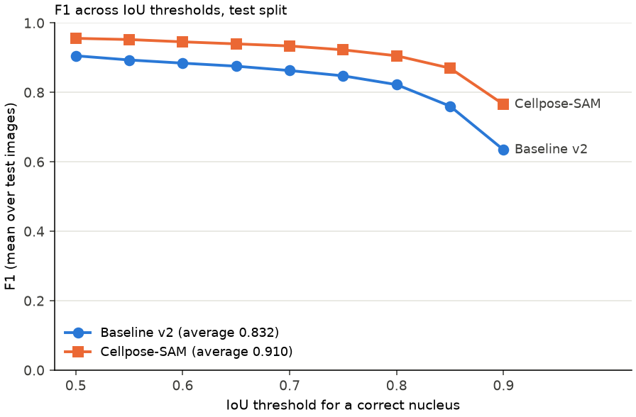
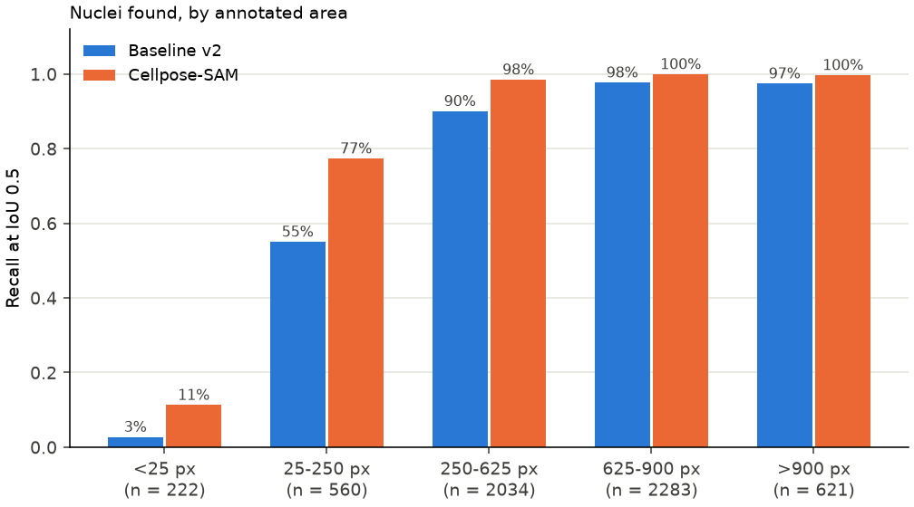
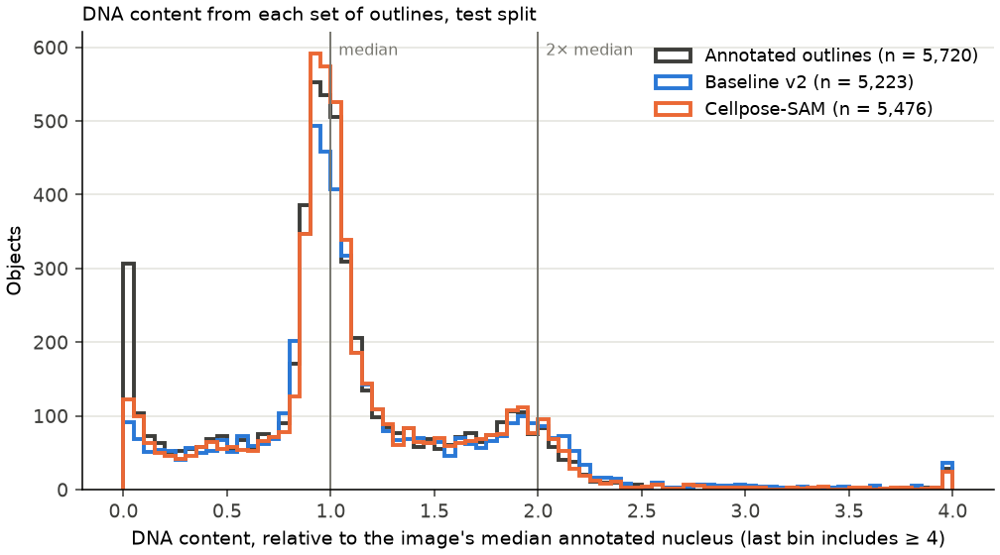
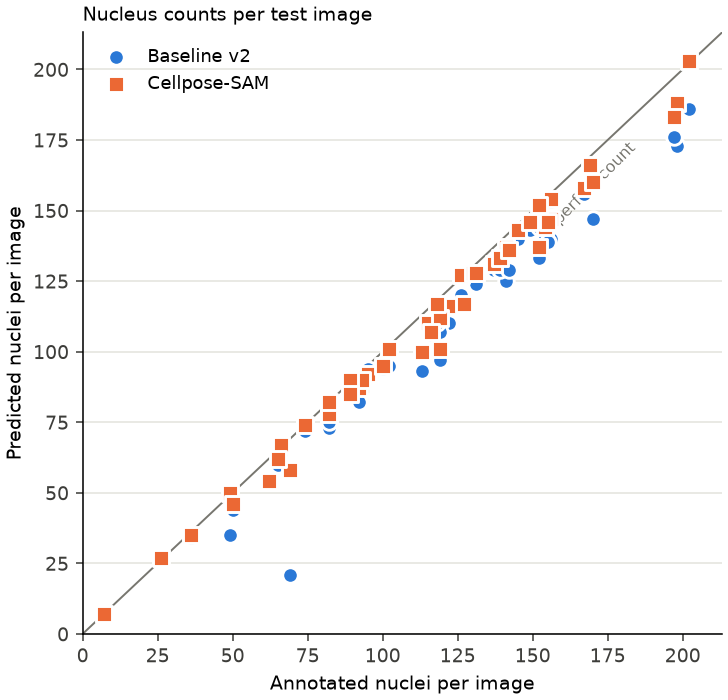
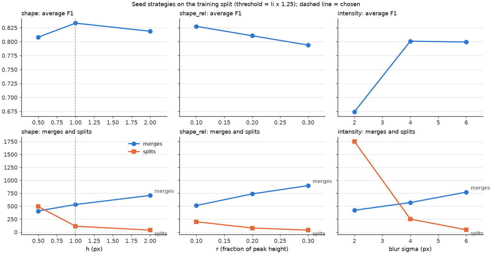
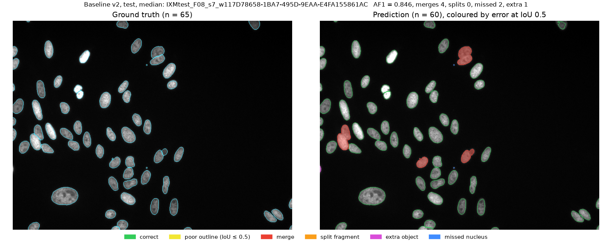
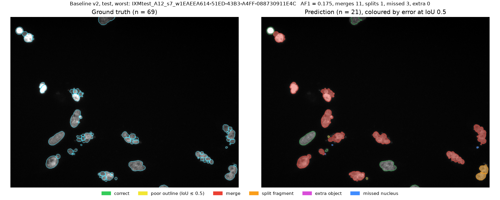
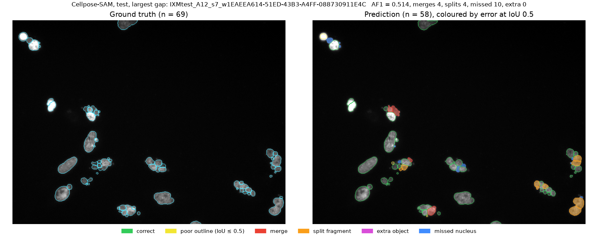
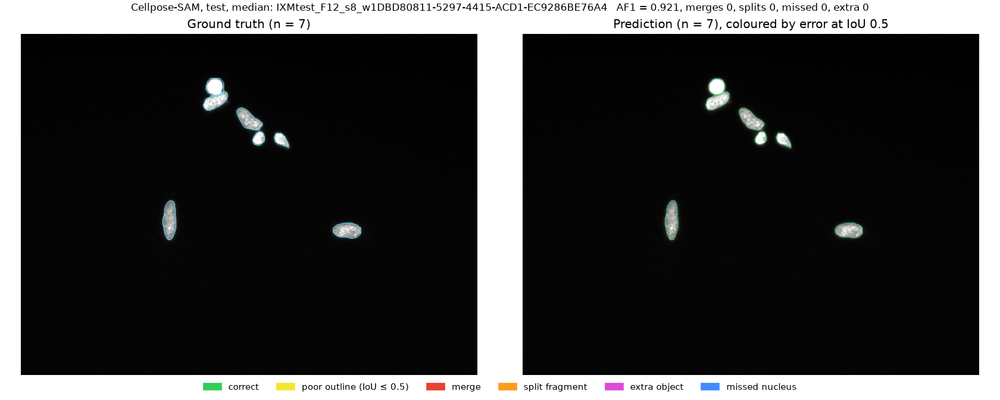
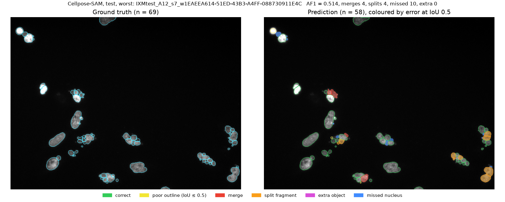

# Results

Generated by `scripts/06_report.py` from the saved summaries; rerun it rather than editing by hand.

## Test split (50 images, scored once)

|  | Baseline v2 | Cellpose-SAM¹ |
|---|---|---|
| Average F1 (IoU 0.50–0.90) | 0.832 | 0.910 |
| F1 at IoU 0.5 | 0.905 | 0.955 |
| Precision / recall at IoU 0.5 | 0.953 / 0.871 | 0.979 / 0.937 |
| Area bias | -0.2% | +0.3% |
| Merges / splits | 255 / 53 | 97 / 25 |
| Missed / extra | 246 / 29 | 214 / 48 |
| Median time per image | 0.10 s, one CPU core | 0.76 s, NVIDIA GeForce RTX 4070 Laptop GPU |

¹ Cellpose has most likely been trained on these images (see README), so its score is a ceiling on seen data, not a generalisation result.

### Compared with published results on the same test images

| Method | Average F1 |
|---|---|
| **Cellpose-SAM (this project, has seen these images)** | 0.910 |
| U-Net | 0.898 |
| DeepCell | 0.858 |
| Random forest | 0.840 |
| **Baseline v2 (this project)** | 0.832 |
| CellProfiler, advanced | 0.811 |
| CellProfiler, basic | 0.790 |

Published numbers: Caicedo et al. 2019, *Cytometry A*.

## Downstream measurements (test split)

DNA content = background-subtracted Hoechst intensity summed over an object, relative to the image's median annotated nucleus (= 1). Whole objects: at least 0.5; high-DNA objects: more than 1.6. In an untreated culture the high-DNA objects would mostly be G2/M cells, but every BBBC039 image shows a different compound, so the scale is used to compare outlines, not to assign cell-cycle phases.

|  | Baseline v2 | Cellpose-SAM |
|---|---|---|
| Nucleus count error per image, mean / worst | 9.0% / 69.6% | 4.5% / 15.9% |
| Nuclei each method found (IoU > 0.5) | 4,980 | 5,361 |
| …area within ±10% of the annotated outline | 74.8% | 86.0% |
| …DNA content within ±10% | 90.4% | 95.4% |
| Nuclei both methods found | 4,950 | 4,950 |
| …area within ±10% of the annotated outline | 75.0% | 87.8% |
| …DNA content within ±10% | 90.5% | 97.0% |
| High-DNA share of whole objects (annotated: 21.3%) | 23.9% | 21.2% |
| …high-DNA objects that are merges (of 2 / of 3+ annotated nuclei) | 146 (117 / 29) | 19 (16 / 3) |
| …high-DNA share without the merges | 21.9% | 21.3% |

## Validation split (used during development)

|  | Baseline v1 | Baseline v2 | Cellpose-SAM |
|---|---|---|---|
| Average F1 (IoU 0.50–0.90) | 0.636 | 0.838 | 0.920 |
| F1 at IoU 0.5 | 0.794 | 0.914 | 0.961 |
| Precision / recall at IoU 0.5 | 0.785 / 0.829 | 0.950 / 0.873 | 0.983 / 0.939 |
| Area bias | +7.5% | -0.2% | +1.0% |
| Merges / splits | 328 / 652 | 219 / 68 | 83 / 32 |
| Missed / extra | 156 / 151 | 292 / 21 | 235 / 29 |

## Error overlays (test split)

## Result files

The small files behind these tables are in [results/](results/): frozen settings, the training grid searches, validation and test summaries, per-image test scores and library versions. Predicted masks and per-object tables are regenerated by the scripts.
